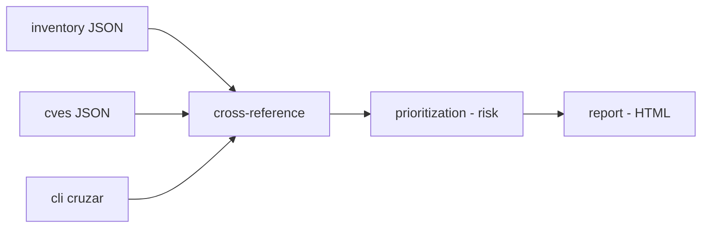

# threat-intel-dashboard

**English** · [Português (Brasil)](README.md)

[](#) [](#) [](LICENSE)

## What it is

A **threat-intelligence curator** (fictitious): it cross-references an **equipment inventory** with a **CVE base** — each with an affected version range — and produces an **exposure/risk report** in HTML. It is an educational threat-intelligence lab in pure Python (stdlib), focused on semantic versioning, affected ranges and risk prioritization.

## Status

An educational security lab, working and tested (189 tests).

## Features

- **CVE base** (`cvedb.py`): loads CVEs (fictitious), normalizes versions and checks `versao_no_alcance` (affected version range).
- **Inventory** (`inventario.py`): a list of equipment with versions.
- **Cross-referencing** (`cruzamento.py`): exposure per equipment × CVE, with version comparison.
- **Prioritization** (`priorizacao.py`): a risk formula to sort exposures.
- **HTML report** (`relatorio.py`): readable output of the cross-reference.
- **CLI**: `cruzar <inventory> <cves> --saida <html>`.
- **CWE/CVSS**: the docstrings and data are fictitious (`dados/`).

## Architecture

An `intelhub` package with separate modules: `cvedb` (CVE base), `inventario`, `cruzamento` (exposure), `priorizacao` (risk) and `relatorio` (HTML), orchestrated by the CLI.



## Stack

- Python ≥ 3.10, stdlib only
- pytest (dev)

## Repository layout

```
threat-intel-dashboard/
├── pyproject.toml · BRIEF.md
├── src/intelhub/
│   ├── cvedb.py · inventario.py · cruzamento.py
│   ├── priorizacao.py · relatorio.py · cli.py
├── dados/
│   ├── cves-ficticias.json
│   └── inventario-equipamentos.json
├── tests/             # 189 tests
└── LICENSE            # MIT
```

## Prerequisites and installation

Python ≥ 3.10.

```bash
pip install -e .
```

## How to run

```bash
intelhub cruzar dados/inventario-equipamentos.json dados/cves-ficticias.json --saida relatorio.html
# or: python -m intelhub cruzar ...
```

## Tests and quality

Real command (verified by the agent):

```bash
PYTHONPATH=src python -m pytest tests/
# 189 passed
```

## Technical decisions and trade-offs

- **Own semantic versioning** (`_comparar`, `versao_no_alcance`): independent of libraries, transparent calculations; the cost is re-implementing what a semver library would do.
- **Fictitious data**: safe and reproducible; it is not real intel.
- **No dependencies (stdlib)**: light and auditable.

## Known limitations and roadmap

- The CVEs and inventory are fictitious — do not use for real security decisions.
- The report covers version-based exposure; it does not include detailed external exploitability.

## Development process

An individual project by Kelvin Oliveira, built with orchestrated AI agents and reviewed by the author. The cross-referencing, the prioritization and the review are the author's.

## License and author

MIT — Copyright (c) 2026 Kelvin Rebelo de Oliveira.

**Author**: [Kelvin Oliveira](https://github.com/KelvinOliveiraCode) · [Portfolio](https://kelvinoliveiracode.github.io/portfolio/)
