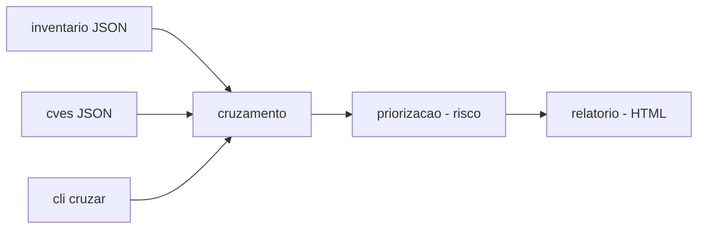

# threat-intel-dashboard

[English](README.en.md) · **Português (Brasil)**

[](#) [](#) [](LICENSE)

## O que é

**Curador de inteligência de ameaça** (fictícia): cruza um **inventário de equipamentos** com uma base de **CVEs** — cada um com versão afetada e faixa — e gera um **relatório de exposição/risco** em HTML. É um laboratório educacional de threat intelligence em Python puro (stdlib), voltado a versionamento semântico, faixas afetadas e priorização de risco.

## Status

Laboratório educacional de segurança, funcional e testado (189 testes).

## Funcionalidades

- **Base de CVEs** (`cvedb.py`): carrega CVEs (fictícias), normaliza versões e verifica `versao_no_alcance` (range de versão afetada).
- **Inventário** (`inventario.py`): lista de equipamentos com versões.
- **Cruzamento** (`cruzamento.py`): exposição por equipamento × CVE, com comparação de versões.
- **Priorização** (`priorizacao.py`): fórmula de risco para ordenar exposições.
- **Relatório HTML** (`relatorio.py`): saída legível do cruzamento.
- **CLI**: `cruzar <inventario> <cves> --saida <html>`.
- **CWE/CVSS**: docstring e dados ficam fictícios (dados em `dados/`).

## Arquitetura

Pacote `intelhub` com módulos separados: `cvedb` (base de CVEs), `inventario`, `cruzamento` (exposição), `priorizacao` (risco) e `relatorio` (HTML), orquestrados pelo CLI.



## Stack

- Python ≥ 3.10, stdlib apenas
- pytest (dev)

## Estrutura do repositório

```
threat-intel-dashboard/
├── pyproject.toml · BRIEF.md
├── src/intelhub/
│   ├── cvedb.py · inventario.py · cruzamento.py
│   ├── priorizacao.py · relatorio.py · cli.py
├── dados/
│   ├── cves-ficticias.json
│   └── inventario-equipamentos.json
├── tests/             # 189 testes
└── LICENSE            # MIT
```

## Pré-requisitos e instalação

Python ≥ 3.10.

```bash
pip install -e .
```

## Como executar

```bash
intelhub cruzar dados/inventario-equipamentos.json dados/cves-ficticias.json --saida relatorio.html
# ou: python -m intelhub cruzar ...
```

## Testes e qualidade

Comando real (verificado pelo agente):

```bash
PYTHONPATH=src python -m pytest tests/
# 189 passed
```

## Decisões técnicas e trade-offs

- **Versionamento semântico próprio** (`_comparar`, `versao_no_alcance`): independente de libs, transparência no cálculo; o custo é reimplementar o que uma lib de semver faria.
- **Dados fictícios**: seguro e reprodutível; não é intel real.
- **Sem dependências (stdlib)**: leve e auditável.

## Limitações conhecidas e roadmap

- CVEs e inventário são fictícios — não usar para decisões reais de segurança.
- O relatório cobre exposição por versão; não inclui exploitabilidade externa detalhada.

## Processo de desenvolvimento

Projeto individual de Kelvin Oliveira, construído com agentes de IA orquestrados e revisado pelo autor. O cruzamento, a priorização e a revisão são do autor.

## Licença e autor

MIT — Copyright (c) 2026 Kelvin Rebelo de Oliveira.

**Autor**: [Kelvin Oliveira](https://github.com/KelvinOliveiraCode) · [Portfólio](https://kelvinoliveiracode.github.io/portfolio/)
